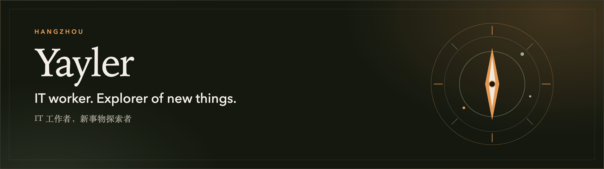
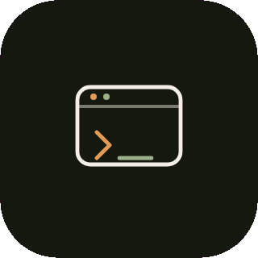
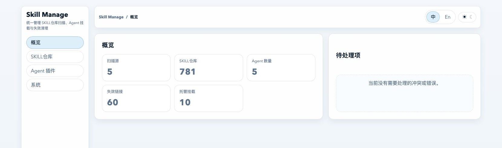

  

IT worker. Explorer of new things. I build local-first tools in Hangzhou.

  <a href="https://im-fan.github.io/"> Blog</a>
  &nbsp;&nbsp;
  <a href="mailto:wyf3634@163.com"> wyf3634@163.com</a>
  &nbsp;&nbsp;
   Hangzhou

## Selected work

<table>
  <tr>
    <td width="88">
      
    </td>
    <td>
      <a href="https://github.com/im-fan/skill-manage"><strong>skill-manage</strong></a> 
      Local skill manager for Codex, Claude Code, Hermes, and OpenClaw. One library, mounted in place. 
      <code>npm install -g @im-fan/skill-manage</code>
    </td>
  </tr>
  <tr>
    <td>
      
    </td>
    <td>
      <a href="https://github.com/im-fan/local-workbench"><strong>local-workbench</strong></a> 
      Edit files and run a shell on a remote container as if they were local. No SSH client. Node.js standard library only. 
      <code>./start.sh start</code>
    </td>
  </tr>
  <tr>
    <td>
      
    </td>
    <td>
      <a href="https://github.com/im-fan/py-tool"><strong>py-tool</strong></a> 
      Python app manager: card list, search, tag filters, SQLite, and an in-browser Monaco editor.
    </td>
  </tr>
  <tr>
    <td>
      
    </td>
    <td>
      <a href="https://github.com/im-fan/GitNexus"><strong>GitNexus</strong></a> 
      Code knowledge graph. I committed <code>gitnexus auto-sync</code> as <strong>Yayler &lt;wyf3634@163.com&gt;</strong>. It is merged upstream in <a href="https://github.com/abhigyanpatwari/GitNexus/pull/2493">#2493</a>: pull configured remotes over SSH on an interval, then analyze new commits.
    </td>
  </tr>
</table>

  

